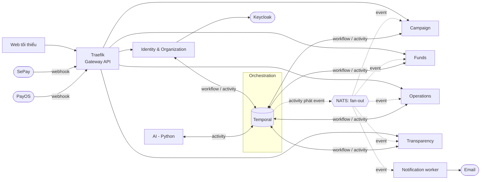
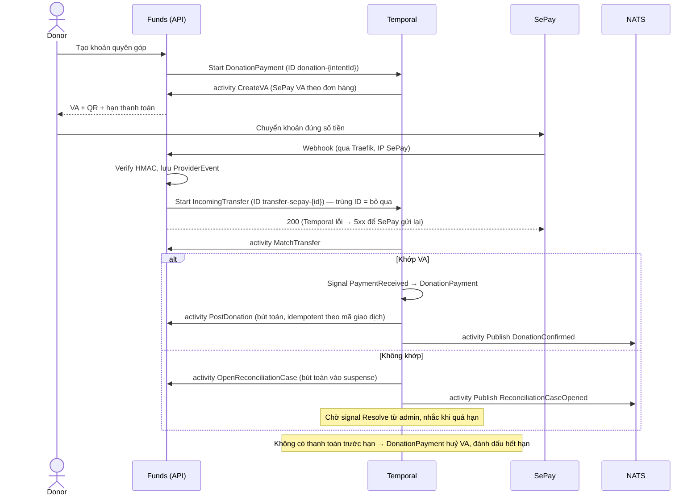
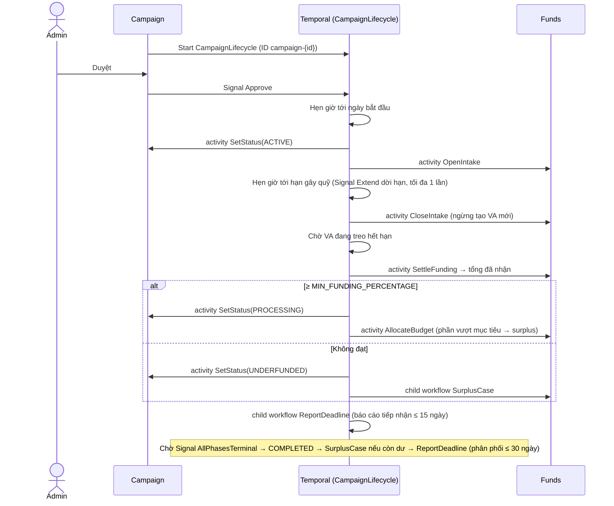
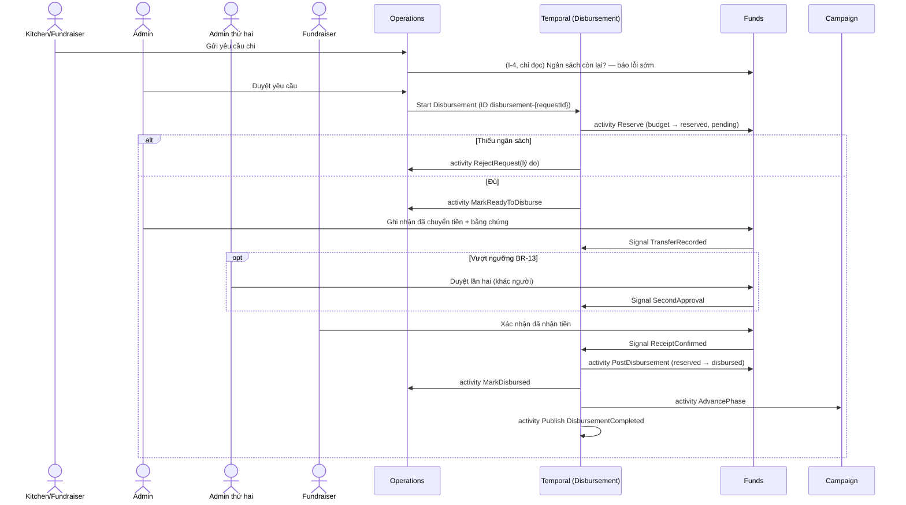

# FoodFund (bản viết lại) — Tách hệ thống (Decomposition)

> **Trạng thái:** v1.1 — 2026-10-10 — viết lại theo [ADR-002](../adr/ADR-002-edge-traefik.md), [ADR-003](../adr/ADR-003-workflow-temporal.md), [ADR-004](../adr/ADR-004-kubernetes-from-day-one.md). Ranh giới 6 service + 1 worker + gateway của v1.0 **giữ nguyên**.
> **Đầu vào:** [`01-requirements.md`](./01-requirements.md) v1.1, [`03-tech-stack.md`](./03-tech-stack.md) v0.4.
> **Thay đổi so với v1.0:**
> - Luồng tiền chuyển từ **choreography** (event + saga tự viết + outbox) sang **orchestration** bằng workflow Temporal có chủ sở hữu rõ ràng.
> - Event bus chỉ còn **phát sự kiện tới read model và tác vụ phụ** (Transparency, Notification, projection).
> - Bỏ transactional outbox: thay đổi cần phát event đi qua workflow (quy tắc C-2).
> - Thêm danh mục workflow, tín hiệu, hợp đồng activity xuyên service, góc nhìn triển khai trên Kubernetes.

---

## 1. Các yếu tố quyết định cách tách

| # | Yếu tố | Hệ quả lên ranh giới |
|---|---|---|
| D-1 | Tiền phải có **một nguồn sự thật** (FR-LED, NFR-01, NFR-03) | Mọi thao tác tiền nằm trong **Funds**; bút toán ghi trong một transaction cục bộ |
| D-2 | Vai trò thay đổi theo tổ chức (FR-ID-02) | Danh tính và tổ chức **cùng service** |
| D-3 | Báo cáo/sao kê cần dữ liệu từ campaign, tiền và chứng từ (FR-TRN) | Một service **chỉ đọc** dựng dữ liệu từ event |
| D-4 | Thông báo, AI, tìm kiếm hỏng không được chặn tiền (NFR-07) | Các phần này không nằm trên đường đi bắt buộc của luồng tiền |
| D-5 | Làm solo 5–6 tháng | Số service tối thiểu có lý do |
| D-6 | **Hệ thống nặng về quy trình:** quy trình dài nhiều ngày, có hẹn giờ và chờ con người (ADR-003) | Mỗi quy trình là **một workflow có chủ sở hữu**; service khác tham gia qua activity |
| D-7 | Kubernetes từ ngày đầu, laptop 16 GB (ADR-004) | Một binary mỗi service (API + worker); không thêm service chỉ vì kỹ thuật |

---

## 2. Danh mục service

| Service | Trách nhiệm | Requirement | Thay cho (hệ thống cũ) |
|---|---|---|---|
| **Identity & Organization** | Tài khoản, vai trò, tổ chức, thành viên, KYC | FR-ID-*, FR-ORG-* | `auth` + phần hồ sơ/tổ chức của `user` |
| **Campaign** | Campaign, phase, kế hoạch ngân sách, **vòng đời campaign**, danh mục, cấu hình, điều phối lại, bài đăng | FR-CMP-*, FR-CFG-01, FR-RSG-01, FR-COM-* | Phần campaign của `campaign` |
| **Funds** | Thanh toán và webhook, đối soát, **sổ cái**, giữ tiền và giải ngân, hoàn tiền, tiền dư, biên nhận, duyệt hai người | FR-PAY-*, FR-LED-*, FR-SUR-01, BR-07, BR-08, BR-11–BR-13 | Donation/payment của `campaign` + ví của `user` + `Inflow_Transaction` của `operation` |
| **Operations** | Yêu cầu chi, phê duyệt yêu cầu, chứng từ, mẻ ăn, giao hàng | FR-DSB-*, FR-KIT-*, FR-DLV-* | `operation` (trừ phần tiền) |
| **Transparency** | Sao kê, báo cáo theo thời hạn, tìm kiếm; **chỉ đọc** dữ liệu nghiệp vụ, sở hữu báo cáo | FR-TRN-*, FR-SRC-* | Search/statement rải rác + OpenSearch CDC |
| **AI** (Python) | Xác minh chứng từ (AI-01); **chỉ là worker activity**, không có API công khai. (AI-04 viết lại tóm tắt báo cáo — giai đoạn 2) | AI-01, NFR-10 | Mới |
| *Notification* (worker) | Gửi email theo event | FR-NTF-01 | Notification của `campaign` |
| *Gateway* | Traefik: TLS, định tuyến `HTTPRoute`, rate limit, lọc IP SePay; **không** nghiệp vụ, **không** xác thực token | NFR-04 | `graphql-gateway` |

**Funds là service lớn nhất** — module nội bộ: `payment`, `reconciliation`, `ledger`, `disbursement`, `refund-surplus`, `approval`.

---

## 3. Bốn kiểu tương tác — dùng kiểu nào khi nào

| Kiểu | Dùng khi | Công cụ | Ví dụ |
|---|---|---|---|
| **I-1 Lệnh từ người dùng** | Người dùng thao tác trên một service | HTTP qua Traefik → service sở hữu dữ liệu | Fundraiser sửa campaign; kitchen nộp chứng từ |
| **I-2 Điều phối quy trình** | Thay đổi nhiều service, có tiền, có hẹn giờ hoặc chờ con người | **Workflow Temporal** do một service sở hữu; service khác tham gia qua **activity** trên task queue của chúng; người dùng tác động bằng **tín hiệu (signal)** | Giải ngân; đóng gây quỹ; tiền dư |
| **I-3 Phát sự kiện** | Thông báo "đã xảy ra" cho read model và tác vụ phụ | NATS JetStream; event được phát bởi **activity** chạy sau khi dữ liệu đã commit | `DonationConfirmed` → Transparency, Notification |
| **I-4 Đọc đồng bộ** | Cần dữ liệu của service khác để trả lời ngay | ConnectRPC, chỉ đọc, có timeout | Operations hỏi Funds ngân sách còn lại để báo lỗi sớm |

**Nguyên tắc chọn:** nếu một thao tác *làm thay đổi* dữ liệu của hơn một service hoặc phải *chờ* (thời gian, con người) → I-2. Nếu chỉ *báo tin* → I-3. Không bao giờ dùng I-3 để điều khiển luồng tiền.

---

## 4. Dữ liệu mỗi service sở hữu

Mỗi service có database riêng trên PostgreSQL 18 (CloudNativePG, ADR-001); không service nào đọc/ghi trực tiếp database của service khác.

| Service | Thực thể sở hữu | Projection từ event |
|---|---|---|
| Identity & Org | User, Organization, Membership, KycSubmission, KycReview | — |
| Campaign | Campaign, Phase, PlannedMeal, PlannedIngredient, Category, SystemConfig, Reassignment, Post, Comment, Like | Tổ chức đã xác minh; tiến độ tiền nhận (chỉ hiển thị) |
| Funds | PaymentIntent, ProviderEvent (webhook thô), ReconciliationCase, Account, JournalEntry, Posting, Reservation, Disbursement, Refund, SurplusCase, Receipt, ApprovalRecord | Kế hoạch ngân sách (phase × hạng mục × %); fundraiser nhận tiền |
| Operations | IngredientRequest (+Item), OperationRequest, ExpenseProof (+AiAnalysis), MealBatch (+IngredientUsage), DeliveryTask (+StatusLog) | Thành viên tổ chức và vai trò; trạng thái campaign/phase |
| Transparency | CampaignStatementLine, Report (+Version, mã băm), SearchDocument | Gần như mọi event công khai (không có dữ liệu cá nhân) |
| AI | AnalysisResult, EvalRun, AuditLog (đầu vào/đầu ra/người duyệt) | — |
| Notification | Lịch sử gửi mail, ContactBook | Liên hệ từ Identity; email nhận biên nhận từ Funds |

**Trạng thái quy trình ≠ dữ liệu nghiệp vụ.** Lịch sử workflow trong Temporal là trạng thái *quy trình* (đang chờ gì, hẹn giờ khi nào). Dữ liệu nghiệp vụ (số dư, trạng thái yêu cầu, trạng thái campaign) luôn được activity ghi vào database của service sở hữu. **UI đọc database của service, không đọc trạng thái từ Temporal.**

**Dữ liệu cá nhân (NFR-13):** chỉ ở Identity & Org, Funds (email tuỳ chọn của khách quyên góp), Notification. Event sang Transparency chỉ mang tên hiển thị hoặc "Ẩn danh".

**Sổ cái (FR-LED)** — tài khoản tối thiểu trong Funds; ngữ nghĩa theo chuyển khoản hai pha (ADR-001):

| Tài khoản | Ý nghĩa |
|---|---|
| `platform_cash` | Tiền thật trong tài khoản ngân hàng nhận |
| `campaign_received:{campaign}` | Tiền quyên góp đã xác nhận |
| `budget:{phase}:{category}` | Ngân sách đã phân bổ cho hạng mục của phase |
| `reserved:{request}` | Tiền đang giữ cho một yêu cầu chi (pending) |
| `disbursed:{campaign}` | Tiền đã chuyển cho fundraiser |
| `surplus:{campaign}` | Tiền dư chờ xử lý (BR-12) |
| `refund_payable:{campaign}` | Tiền phải hoàn cho donor |
| `suspense` | Tiền vào chưa khớp (FR-PAY-10) |

---

## 5. Danh mục workflow

Mỗi service có **task queue riêng** cùng tên (`identity`, `campaign`, `funds`, `operations`, `transparency`, `ai`). Workflow chạy trên task queue của service sở hữu; activity của service khác được gọi qua task queue của service đó.

| Workflow | Sở hữu | Khởi động bởi | ID (tất định, chống trùng) | Hẹn giờ | Tín hiệu | Activity ở service khác |
|---|---|---|---|---|---|---|
| `CampaignLifecycle` | Campaign | Fundraiser nộp campaign | `campaign-{id}` | Hạn duyệt; ngày bắt đầu; hạn gây quỹ; thời gian chờ giao dịch treo | `Approve`, `Reject`, `Extend` (FR-CMP-04), `Cancel`, `AllPhasesTerminal` | Funds: `OpenIntake`, `CloseIntake`, `SettleFunding`, `AllocateBudget`; khởi động `SurplusCase`, `ReportDeadline` (workflow con) |
| `DonationPayment` | Funds | Donor tạo khoản quyên góp | `donation-{intentId}` | Hết hạn VA / link (FR-PAY-05) | `PaymentReceived` | — |
| `IncomingTransfer` | Funds | Webhook đã verify | `transfer-{provider}-{providerTxnId}` | Hạn xử lý đối soát (FR-PAY-10) | `Resolve` (admin gán donation / hoàn tiền) | — |
| `Disbursement` | Funds | Operations sau khi admin duyệt yêu cầu | `disbursement-{requestId}` | Hạn chờ xác nhận nhận tiền (ví dụ 7 ngày) | `TransferRecorded`, `SecondApproval` (BR-13), `ReceiptConfirmed`, `ReceiptDisputed`, `AdminResolved` | Operations: `MarkReadyToDisburse`, `MarkDisbursed`, `RejectRequest`, `MarkDisbursementFailed`; Campaign: `AdvancePhase` |
| `ExpenseProofAnalysis` | Operations | Kitchen nộp chứng từ | `proof-{proofId}` | Timeout phân tích | — | AI: `AnalyzeReceipt` (Python) |
| `SurplusCase` | Funds | `CampaignLifecycle` (UNDERFUNDED / CANCELLED / còn dư sau COMPLETED) | `surplus-{campaignId}` | Hạn phản đối của donor | `PlanApproved`, `DonorObjected` | Identity: lấy danh sách liên hệ donor (đọc) |
| `ReportDeadline` | Transparency | `CampaignLifecycle` (đóng gây quỹ → báo cáo tiếp nhận ≤ 15 ngày; hoàn thành → báo cáo phân phối ≤ 30 ngày) | `report-{campaignId}-{kind}` | Hạn công khai; nhắc trước hạn | `Retry` | Funds: `GetLedgerTotals` (đối chiếu). Tóm tắt bằng lời sinh từ template trong Transparency (giai đoạn 2 có thể thêm AI: `RewriteSummary`, AI-04) |
| `CampaignReassignment` [C] | Campaign | Admin đề xuất | `reassign-{campaignId}-{n}` | 7 ngày (BR-09) | `Accept`, `Decline` | — |
| `DailyReconciliation` | Funds | Temporal Schedule | theo ngày | — | — | — |
| `RecordAndPublish` (mẫu chung, workflow ngắn) | Service sở hữu dữ liệu | Thao tác I-1 cần phát event: xác minh tổ chức, duyệt thành viên, sửa campaign, duyệt chứng từ… | `{loại}-{entityId}-{phiên bản}` | — | — | Không — chỉ gồm activity ghi DB → activity phát event (C-2) |

**Hợp đồng activity xuyên service** (ví dụ `operations.MarkDisbursed`) là API nội bộ: định nghĩa trong `proto/`, có phiên bản, có contract test như event (C-6).

---

## 6. Danh mục event (chỉ để phát tin)

Quy ước: thì quá khứ; có `eventId`, `occurredAt`, `correlationId`, `schemaVersion`; payload chỉ chứa định danh và dữ liệu cần thiết; **không có dữ liệu cá nhân trong event công khai**.

| Event | Phát bởi | Tiêu thụ bởi | Mục đích |
|---|---|---|---|
| `OrganizationVerified` / `OrganizationRejected` | Identity & Org | Campaign, Funds, Notification | Projection: tổ chức được tạo campaign; fundraiser nhận tiền |
| `MembershipApproved` / `MembershipEnded` | Identity & Org | Operations, Notification | Projection quyền của staff |
| `CampaignApproved` / `CampaignActivated` / `CampaignCancelled` / `CampaignCompleted` | Campaign | Transparency, Notification, Operations | Trang công khai, thông báo, chặn yêu cầu khi campaign không còn chạy |
| `CampaignFundingClosed{outcome}` | Campaign | Transparency, Notification | Hiển thị kết quả gây quỹ |
| `PhaseStatusChanged` | Campaign | Operations, Transparency | Projection trạng thái phase |
| `DonationConfirmed` | Funds | Campaign, Transparency, Notification | Tiến độ hiển thị, sao kê, biên nhận |
| `BudgetAllocated` | Funds | Transparency | Ngân sách từng hạng mục |
| `RequestDecided{approved/rejected}` | Operations | Notification | Báo người gửi |
| `DisbursementCompleted` / `DisbursementFailed` | Funds | Transparency, Notification | Sao kê tiền ra |
| `ExpenseProofReviewed` | Operations | Transparency, Notification | Chứng từ công khai sau khi duyệt |
| `RefundCompleted` / `SurplusResolved` | Funds | Transparency, Notification | Sao kê tiền ra; báo donor |
| `SurplusNoticeRequested` | Funds | Notification | Gửi thông báo phương án tiền dư kèm hạn phản đối |
| `ReconciliationCaseOpened` | Funds | Notification | Cảnh báo admin có tiền chưa khớp |
| `ReportPublished` | Transparency | Notification | Báo donor có báo cáo mới |

Các event của v1.0 dùng để điều khiển luồng (`FundingWindowClosed`, `FundingSettled`, `RequestApproved` → Funds, `ReservationCreated/Rejected`, `DisbursementSent`, `ExpenseProofSubmitted` → AI, `ExpenseProofAnalyzed`) **đã bị bỏ** — nay là bước trong workflow.

---

## 7. Luồng xuyên service

### 7.1 Quyên góp

### 7.2 Vòng đời campaign và đóng gây quỹ

Tiền đến sau khi đã chốt → `IncomingTransfer` không khớp VA đang mở → vào `suspense` và hàng chờ đối soát.

### 7.3 Giải ngân

**Hết hạn chờ xác nhận hoặc fundraiser báo chưa nhận:** **không tự hoàn lại phần đã giữ**, vì tiền có thể đã thực sự rời tài khoản. Workflow mở case đối soát và chờ `AdminResolved`; chỉ khi admin xác định tiền chưa chuyển mới chạy bút toán đảo `reserved → budget` và `MarkDisbursementFailed`.

Kiểm tra ngân sách đồng bộ ở bước gửi yêu cầu chỉ để báo lỗi sớm; **quyết định có hiệu lực là activity `Reserve` trong Funds**.

### 7.4 Chứng từ và AI

Kitchen (hoặc fundraiser nộp thay) chụp và gửi ảnh, khai tổng tiền → Operations ghi `ExpenseProof`, tính perceptual hash và gắn cờ trùng ảnh (FR-DSB-08, không qua AI) → khởi động `ExpenseProofAnalysis` (bỏ qua ảnh loại video/hàng hoá) → activity `AnalyzeReceipt` chạy trên worker Python (task queue `ai`) có timeout và số lần thử giới hạn → Operations lưu kết quả và cờ sai lệch. Admin duyệt chứng từ bằng thao tác I-1 thường; **không chờ AI**. AI lỗi hoặc hết thời gian → chứng từ hiển thị "chưa có phân tích AI" (NFR-07).

### 7.5 Tiền dư (BR-12)

`SurplusCase` tính số dư → chờ `PlanApproved` (admin) → phát `SurplusNoticeRequested` → hẹn giờ hết hạn phản đối, nhận `DonorObjected` → hoàn tiền cho donor phản đối (activity `Refund`) → chuyển phần còn lại theo phương án đã cam kết (bút toán hai chiều) → phát `SurplusResolved`.

---

## 8. Quy tắc giao tiếp và xử lý lỗi

| Quy tắc | Nội dung |
|---|---|
| **C-1 Chọn kiểu tương tác theo mục 3** | Luồng tiền và mọi thao tác thay đổi nhiều service đi qua workflow (I-2); event chỉ để phát tin (I-3) |
| **C-2 Không outbox** | Thay đổi **cần phát event** đi qua workflow: activity ghi DB → activity phát event (giao ít nhất một lần). Thay đổi chỉ nội bộ một service dùng transaction thường, không phát event. *Kiểm chứng ở spike S-3; nếu quá nặng cho thao tác đơn giản → bổ sung outbox tối thiểu trong `libs/events`.* |
| **C-3 Idempotent ở mọi nơi** | Workflow ID tất định (mục 5); activity ghi bằng khoá chống trùng (UNIQUE theo mã giao dịch / ID workflow + bước); consumer event lưu `eventId` đã xử lý |
| **C-4 Thử lại và hàng lỗi** | Activity: retry policy của Temporal có giãn cách và giới hạn; consumer NATS: giới hạn số lần gửi → hàng lỗi + cảnh báo |
| **C-5 Đọc đồng bộ có dự phòng** | I-4 chỉ để đọc, có timeout; không phụ thuộc kết quả đọc để quyết định tiền |
| **C-6 Hợp đồng có phiên bản** | Event, activity xuyên service, RPC: định nghĩa trong `proto/`, `buf breaking` trong CI; workflow thay đổi dùng versioning của Temporal + replay test |
| **C-7 Phân quyền tại service sở hữu** | Service tự xác thực JWT; kiểm tra quyền sở hữu tài nguyên tại service sở hữu dữ liệu; **tín hiệu gửi tới workflow chỉ được gửi từ service sở hữu sau khi đã kiểm tra quyền** — người dùng không gửi tín hiệu trực tiếp |
| **C-8 Truy vết** | `correlationId` đi từ request gốc qua workflow, activity, event và log |
| **C-9 Webhook** | Traefik chuyển nguyên vẹn; Funds verify chữ ký trước khi khởi động workflow; trả 5xx khi không khởi động được workflow để nhà cung cấp gửi lại |
| **C-10 Workflow tất định** | Không I/O, không `time.Now`, không goroutine, không ngẫu nhiên trong code workflow (ADR-003) |

**Khi một thành phần ngừng:**

| Thành phần ngừng | Ảnh hưởng | Hệ thống phản ứng |
|---|---|---|
| Temporal | Không khởi động / tiến triển được quy trình | API đọc vẫn chạy; lệnh cần workflow trả 503; webhook trả 5xx → SePay/PayOS gửi lại; workflow tự chạy tiếp khi Temporal lên |
| NATS | Read model và email chậm | Activity phát event retry; tiền không bị ảnh hưởng |
| AI | Không có phân tích chứng từ | Chứng từ vẫn duyệt được (NFR-07) |
| Một service | Activity trên task queue của nó chờ | Workflow tự tiếp tục khi service lên lại; không mất trạng thái |
| PostgreSQL | Toàn hệ thống dừng | Điểm hỏng chung đã chấp nhận; PITR qua CloudNativePG (ADR-001) |

---

## 9. Góc nhìn triển khai trên Kubernetes (ADR-004)

| Namespace | Thành phần |
|---|---|
| `edge` | Traefik (controller Gateway API), `Gateway` công khai; cert-manager (demo) |
| `infra` | CloudNativePG cluster, Temporal + UI, NATS, Keycloak, SeaweedFS, Mailpit, `otel-lgtm` (tuỳ chọn) |
| `foodfund` | 6 service + Notification worker |

- **Mỗi service một binary** chạy cả HTTP API và Temporal worker của task queue tương ứng; tách thành hai Deployment sau nếu cần mở rộng riêng.
- Probe `/healthz`, `/readyz`; tắt êm khi SIGTERM (dừng nhận việc mới, chờ activity đang chạy) — NFR-14.

**Bảng route công khai** (dịch trực tiếp thành `HTTPRoute`):

| Đường dẫn | Service | Chính sách ở biên |
|---|---|---|
| `/api/identity/*` | Identity & Org | Rate limit |
| `/api/campaigns/*` | Campaign | Rate limit |
| `/api/funds/*` | Funds | Rate limit |
| `/api/operations/*` | Operations | Rate limit |
| `/api/transparency/*` | Transparency | Rate limit |
| `/webhooks/sepay` | Funds | Lọc IP SePay, giới hạn body |
| `/webhooks/payos` | Funds | Giới hạn body |
| `/auth/*` | Keycloak (luồng đăng nhập công khai) | Rate limit; **không** mở console admin |

**Không công khai:** service AI, Temporal UI, NATS, PostgreSQL, console admin Keycloak, dashboard Traefik (truy cập qua port-forward).

---

## 10. Truy vết requirement → service / workflow

| Nhóm requirement | Service chính | Workflow liên quan |
|---|---|---|
| FR-ID, FR-ORG | Identity & Org | — |
| FR-CMP, FR-CFG, BR-01, BR-02, BR-06, BR-09 | Campaign | `CampaignLifecycle`, `CampaignReassignment` |
| FR-PAY, BR-08, BR-11 | Funds | `DonationPayment`, `IncomingTransfer`, `DailyReconciliation` |
| FR-LED, BR-05, BR-07, BR-13, BR-14 | Funds | `Disbursement` |
| FR-SUR, BR-12 | Funds | `SurplusCase` |
| FR-DSB, BR-03, BR-04 | Operations | `Disbursement`, `ExpenseProofAnalysis` |
| FR-KIT, FR-DLV | Operations | — |
| FR-NTF | Notification | (tiêu thụ event) |
| FR-TRN, FR-SRC | Transparency | `ReportDeadline` |
| AI-01, NFR-10 | AI | `ExpenseProofAnalysis` |
| AI-04 [C] | AI | `ReportDeadline` (giai đoạn 2) |
| FR-RSG | Campaign | `CampaignReassignment` |

**Báo cáo công khai (FR-TRN-02):** `ReportDeadline` đối chiếu tổng tiền của báo cáo với sổ cái qua activity `funds.GetLedgerTotals`; lệch → không phát hành, cảnh báo admin, chờ `Retry`.

---

## 11. Rủi ro

| Rủi ro | Giảm thiểu |
|---|---|
| Funds quá lớn | Module nội bộ rõ ràng; có thể tách `payment` sau |
| Activity xuyên service tạo phụ thuộc chặt giữa các service | Hợp đồng trong `proto/` có phiên bản (C-6); số activity xuyên service giữ ít (mục 5) |
| Sai luật tất định làm workflow lỗi khi replay | Replay test trong CI; lint/review cho code workflow (C-10) |
| Mọi thay đổi cần phát event phải qua workflow → nặng cho thao tác đơn giản | Spike S-3; phương án dự phòng: outbox tối thiểu |
| Temporal là thành phần trung tâm mới | Trạng thái lưu trên PostgreSQL có PITR; thử kịch bản Temporal ngừng (mục 8) |
| Nhất quán cuối cùng ở read model (vừa chuyển khoản nhưng sao kê chưa cập nhật) | UI hiển thị "đang xác nhận"; tiến độ chính thức lấy từ Funds |
| RAM local (ADR-004) | LGTM tuỳ chọn; đo ở S-4 |

---

## 12. Liên kết quyết định

| Chủ đề | Quyết định |
|---|---|
| Ngôn ngữ | Go cho service lõi, Python cho AI (`03-tech-stack.md` T-1) |
| Database | PostgreSQL 18 + CloudNativePG — [ADR-001](../adr/ADR-001-database-postgresql.md) |
| Lớp biên | Traefik qua Gateway API — [ADR-002](../adr/ADR-002-edge-traefik.md) |
| Điều phối | Temporal — [ADR-003](../adr/ADR-003-workflow-temporal.md) |
| Hạ tầng | Kubernetes từ ngày đầu — [ADR-004](../adr/ADR-004-kubernetes-from-day-one.md) |
| Còn mở | T-2 (kiểu API), T-3, T-4 (NATS — có thể bỏ sau S-3), T-8 … T-13; spike S-1 … S-10 |
