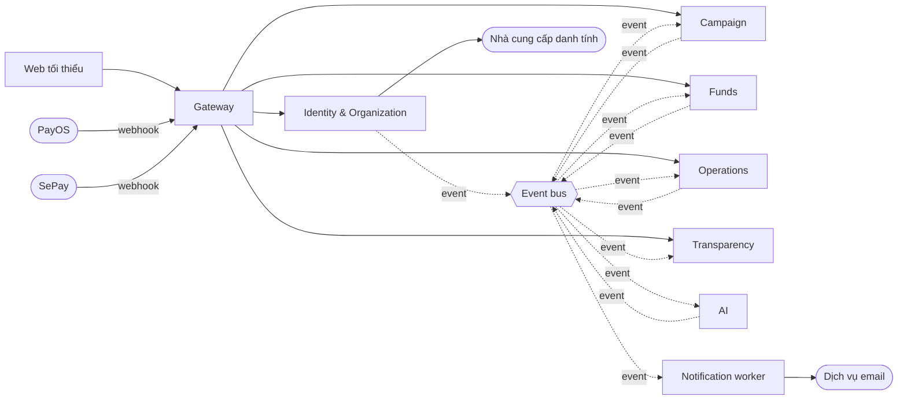
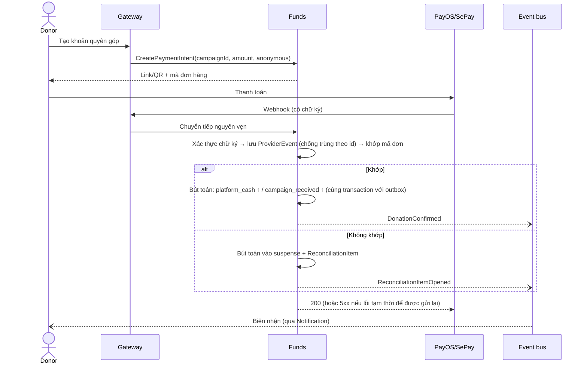
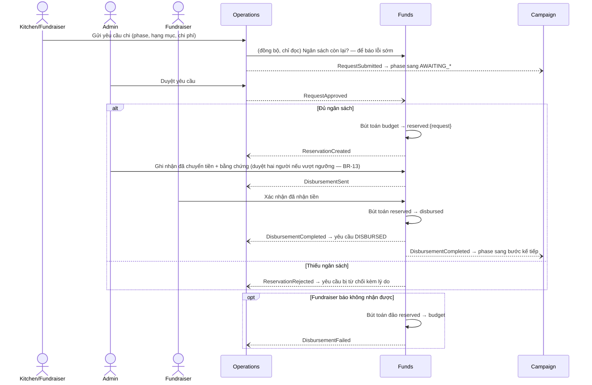

# FoodFund (bản viết lại) — Tách hệ thống (Decomposition)

> **Trạng thái:** v1.0 — 2026-10-09 — chủ dự án đã đồng ý phương án 6 service + 1 worker + gateway.
> **Đầu vào:** [`01-requirements.md`](./01-requirements.md) v1.0.
> **Phạm vi tài liệu:** ranh giới service, dữ liệu mỗi service sở hữu, event, luồng xuyên service, xử lý lỗi. **Không** chọn ngôn ngữ, cơ sở dữ liệu, broker hay kiểu API — các quyết định đó nằm ở `03-tech-stack.md` (mục 9 liệt kê những gì cần quyết định).

---

## 1. Các yếu tố quyết định cách tách

| # | Yếu tố (từ requirements) | Hệ quả lên ranh giới |
|---|---|---|
| D-1 | Tiền phải có **một nguồn sự thật** (FR-LED, NFR-01, NFR-03); hệ thống cũ chia tiền ra 3 nơi và lệch nhau (mục 8 của requirements) | Mọi thao tác tiền nằm trong **một service (Funds)**, bút toán ghi trong một transaction cục bộ |
| D-2 | Vai trò thay đổi theo tổ chức (FR-ID-02) | Danh tính và tổ chức nằm **cùng service** |
| D-3 | Báo cáo/sao kê cần dữ liệu từ campaign, tiền và chứng từ (FR-TRN) | Một service **chỉ đọc**, dựng dữ liệu từ event, không gọi đồng bộ sang nhiều nơi |
| D-4 | Thông báo, AI, tìm kiếm hỏng không được chặn tiền (NFR-07) | Các phần này chỉ **tiêu thụ event**, không nằm trên đường đi đồng bộ của luồng tiền |
| D-5 | Làm solo 5–6 tháng | Giữ số service ở mức tối thiểu có lý do; chỉ **một saga** (giải ngân) |

---

## 2. Danh mục service



| Service | Trách nhiệm | Requirement | Thay cho (hệ thống cũ) |
|---|---|---|---|
| **Identity & Organization** | Tài khoản, vai trò, tổ chức, thành viên, KYC | FR-ID-*, FR-ORG-* | `auth` + phần hồ sơ/tổ chức của `user` |
| **Campaign** | Campaign, phase, kế hoạch ngân sách, vòng đời & lịch tự động, danh mục, cấu hình, điều phối lại, bài đăng | FR-CMP-*, FR-CFG-01, FR-RSG-01, FR-COM-* | Phần campaign của `campaign` |
| **Funds** | Payment intent, webhook, đối soát, **sổ cái**, giữ tiền & giải ngân, hoàn tiền, tiền dư, biên nhận, duyệt hai người cho thao tác tiền | FR-PAY-*, FR-LED-*, FR-SUR-01, BR-07, BR-08, BR-11–BR-13 | Phần donation/payment của `campaign` + ví của `user` + `Inflow_Transaction` của `operation` |
| **Operations** | Yêu cầu chi, phê duyệt, chứng từ, mẻ ăn, giao hàng | FR-DSB-*, FR-KIT-*, FR-DLV-* | `operation` (trừ phần tiền) |
| **Transparency** | Sao kê, báo cáo theo thời hạn, tìm kiếm; **chỉ đọc** | FR-TRN-*, FR-SRC-* | Phần search/statement rải rác + OpenSearch CDC |
| **AI** | Xác minh chứng từ (AI-01), tóm tắt báo cáo (AI-04) | AI-01, AI-04, NFR-10 | Mới |
| *Notification* (worker) | Gửi email theo event; không có API | FR-NTF-01 | Phần notification của `campaign` |
| *Gateway* | Điểm vào duy nhất; xác thực token; định tuyến; **không** chứa nghiệp vụ | NFR-04 | `graphql-gateway` |

**Funds là service lớn nhất** — bên trong chia module rõ ràng (`payment`, `reconciliation`, `ledger`, `disbursement`, `refund-surplus`, `approval`) để có thể tách `payment` ra thành service riêng sau này nếu cần (phương án 7 service đã cân nhắc và hoãn lại).

---

## 3. Dữ liệu mỗi service sở hữu

Mỗi service có cơ sở dữ liệu riêng; **không** service nào đọc/ghi trực tiếp dữ liệu của service khác.

| Service | Thực thể sở hữu | Bản sao cục bộ (projection) từ event |
|---|---|---|
| Identity & Org | User, Organization, Membership, KycSubmission, KycReview | — |
| Campaign | Campaign, Phase, PlannedMeal, PlannedIngredient, Category, SystemConfig, Reassignment, Post, Comment, Like | Tổ chức đã xác minh, fundraiser của tổ chức; tiến độ tiền nhận (chỉ để hiển thị) |
| Funds | PaymentIntent, ProviderEvent (webhook thô), ReconciliationItem, Account, JournalEntry, Posting, Reservation, Disbursement, Refund, SurplusCase, Receipt, ApprovalRequest | Kế hoạch ngân sách của campaign (phase × hạng mục × %); fundraiser nhận tiền |
| Operations | IngredientRequest (+Item), OperationRequest, ExpenseProof, MealBatch (+IngredientUsage), DeliveryTask (+StatusLog) | Thành viên tổ chức & vai trò; trạng thái campaign/phase; kết quả phân tích AI cho chứng từ |
| Transparency | CampaignStatementLine, Report (+Version), SearchDocument | Gần như mọi event công khai (không có dữ liệu cá nhân) |
| AI | AnalysisJob, AnalysisResult, EvalRun, AuditLog (đầu vào/đầu ra/người duyệt) | — |
| Notification | Outbox gửi mail, ContactBook (email người nhận) | Thông tin liên hệ từ Identity; email nhận biên nhận từ Funds |

**Dữ liệu cá nhân (NFR-13):** chỉ nằm ở Identity & Org, Funds (email tuỳ chọn của khách quyên góp) và Notification. Event gửi sang Transparency chỉ mang **tên hiển thị hoặc "Ẩn danh"**, không mang email, số điện thoại, số tài khoản.

**Sổ cái (FR-LED):** các loại tài khoản tối thiểu trong Funds:

| Tài khoản | Ý nghĩa |
|---|---|
| `platform_cash` | Tiền thật trong tài khoản ngân hàng nhận |
| `campaign_received:{campaign}` | Tiền quyên góp đã xác nhận của campaign |
| `budget:{phase}:{category}` | Ngân sách đã phân bổ cho hạng mục nguyên liệu/nấu/giao của phase |
| `reserved:{request}` | Tiền đang giữ cho một yêu cầu chi đã duyệt |
| `disbursed:{campaign}` | Tiền đã chuyển cho fundraiser |
| `surplus:{campaign}` | Tiền dư chờ xử lý theo BR-12 |
| `refund_payable:{campaign}` | Tiền phải hoàn cho donor |
| `suspense` | Tiền vào chưa khớp được (hàng chờ đối soát FR-PAY-10) |

Số dư mọi tài khoản = tổng bút toán (FR-LED-02); tổng nợ = tổng có cho mỗi JournalEntry.

---

## 4. Danh mục event

Quy ước: tên ở thì quá khứ; mỗi event có `eventId`, `occurredAt`, `correlationId`, `schemaVersion`; payload chỉ chứa định danh và dữ liệu cần thiết.

| Event | Phát bởi | Tiêu thụ bởi | Mục đích |
|---|---|---|---|
| `OrganizationVerified` / `OrganizationRejected` | Identity & Org | Campaign, Funds, Notification | Cho phép tổ chức tạo campaign; biết fundraiser nhận tiền |
| `MembershipApproved` / `MembershipEnded` | Identity & Org | Operations, Notification | Quyền tạo yêu cầu, nhận việc giao hàng |
| `CampaignApproved` | Campaign | Funds, Transparency, Notification | Funds tạo định danh nhận tiền (BR-11) và lưu kế hoạch ngân sách |
| `CampaignActivated` | Campaign | Funds, Transparency | Funds bắt đầu nhận quyên góp |
| `FundingWindowClosed` | Campaign | Funds | Ngừng tạo payment intent mới; bắt đầu chốt số liệu |
| `FundingSettled` | Funds | Campaign | Tổng tiền đã nhận sau thời gian chờ giao dịch treo |
| `CampaignFundingClosed{outcome}` | Campaign | Funds, Transparency, Notification | `PROCESSING` → Funds phân bổ ngân sách; `UNDERFUNDED` → Funds mở SurplusCase (BR-12) |
| `CampaignCancelled` | Campaign | Funds, Operations, Transparency, Notification | Funds mở SurplusCase; Operations huỷ yêu cầu đang mở |
| `PhaseStatusChanged` / `CampaignCompleted` | Campaign | Operations, Transparency, Funds | Ràng buộc nghiệp vụ theo phase; báo cáo phân phối |
| `DonationConfirmed` / `DonationFailed` | Funds | Campaign, Transparency, Notification | Tiến độ, sao kê, biên nhận |
| `BudgetAllocated` | Funds | Transparency, Operations | Ngân sách từng hạng mục sau khi chốt |
| `RequestSubmitted` | Operations | Campaign | Campaign chuyển phase sang AWAITING_* (BR-02) |
| `RequestApproved` / `RequestRejected` | Operations | Funds, Notification | Funds giữ tiền; báo người gửi |
| `ReservationCreated` / `ReservationRejected` | Funds | Operations | Yêu cầu sẵn sàng giải ngân / bị từ chối do thiếu ngân sách |
| `DisbursementSent` | Funds | Operations, Notification | Admin đã chuyển tiền, chờ fundraiser xác nhận |
| `DisbursementCompleted` / `DisbursementFailed` | Funds | Operations, Campaign, Transparency | Yêu cầu → DISBURSED; phase sang bước kế tiếp; sao kê tiền ra |
| `ExpenseProofSubmitted` | Operations | AI, Transparency | AI phân tích chứng từ |
| `ExpenseProofAnalyzed` | AI | Operations | Gắn cờ sai lệch để admin xem khi duyệt |
| `ExpenseProofReviewed` | Operations | Transparency, Notification | Chứng từ được công khai sau khi duyệt |
| `RefundCompleted` / `SurplusResolved` | Funds | Transparency, Notification | Sao kê tiền ra; báo donor |
| `ReconciliationItemOpened` | Funds | Notification | Cảnh báo admin có tiền chưa khớp |
| `ReportPublished` | Transparency | AI, Notification | AI-04 tóm tắt; báo donor |

---

## 5. Luồng xuyên service

### 5.1 Quyên góp



### 5.2 Đóng gây quỹ

Mục tiêu: không để giao dịch đến muộn làm sai quyết định PROCESSING/UNDERFUNDED.

```mermaid
sequenceDiagram
    participant C as Campaign (lịch tự động)
    participant BUS as Event bus
    participant F as Funds
    C--)BUS: FundingWindowClosed(campaignId)
    BUS--)F: FundingWindowClosed
    F->>F: Ngừng tạo payment intent; chờ intent treo hết hạn
    F--)BUS: FundingSettled(totalReceived)
    BUS--)C: FundingSettled
    C->>C: So với MIN_FUNDING_PERCENTAGE (BR-01)
    C--)BUS: CampaignFundingClosed(outcome)
    alt PROCESSING
        BUS--)F: Phân bổ min(received, target) × % vào budget:{phase}:{category}; phần vượt vào surplus
    else UNDERFUNDED
        BUS--)F: Mở SurplusCase (BR-12)
    end
```

Tiền đến sau khi đã chốt → vào `suspense` và hàng chờ đối soát, không tự cộng vào campaign.

Riêng trường hợp **vượt mục tiêu khi còn ACTIVE** (BR-01): Campaign tự phát `FundingWindowClosed` sớm khi tiến độ hiển thị vượt mục tiêu; quyết định cuối vẫn dựa trên `FundingSettled`.

### 5.3 Giải ngân — saga duy nhất



Kiểm tra ngân sách đồng bộ ở bước gửi yêu cầu chỉ để báo lỗi sớm cho người dùng; **quyết định có hiệu lực là bước giữ tiền trong Funds** (tránh hai yêu cầu cùng vượt qua kiểm tra).

### 5.4 Chứng từ & AI

Operations nhận chứng từ → phát `ExpenseProofSubmitted` → AI phân tích (trích xuất, so với yêu cầu và số đã giải ngân) → `ExpenseProofAnalyzed` gắn cờ vào chứng từ → admin duyệt. Nếu AI không phản hồi, admin vẫn duyệt được bình thường; giao diện hiển thị "chưa có phân tích AI" (NFR-07).

### 5.5 Tiền dư (BR-12)

Funds mở `SurplusCase` (khi UNDERFUNDED, CANCELLED, hoặc còn tiền sau COMPLETED) → admin duyệt phương án đã cam kết → Notification gửi thông báo donor kèm hạn phản đối → donor phản đối được tạo Refund → hết hạn: chuyển phần còn lại theo phương án → `SurplusResolved`.

---

## 6. Quy tắc giao tiếp & xử lý lỗi

| Quy tắc | Nội dung |
|---|---|
| **C-1 Event là mặc định** | Thay đổi trạng thái giữa các service đi qua event; không gọi đồng bộ để *ghi* sang service khác |
| **C-2 Transactional outbox** | Service ghi dữ liệu và event vào cùng một transaction; tiến trình relay đẩy event lên bus |
| **C-3 Consumer idempotent** | Mỗi consumer lưu `eventId` đã xử lý (inbox); nhận lặp thì bỏ qua |
| **C-4 Thử lại & hàng lỗi** | Lỗi tạm thời thử lại có giãn cách; quá số lần → hàng lỗi (dead-letter) + cảnh báo |
| **C-5 Đọc đồng bộ có dự phòng** | Chỉ dùng cho truy vấn đọc (ví dụ ngân sách còn lại); có timeout và hành vi khi bên kia không phản hồi |
| **C-6 Phiên bản event** | Thêm trường không phá vỡ consumer; thay đổi phá vỡ → tên/phiên bản mới; có contract test |
| **C-7 Phân quyền tại service sở hữu** | Gateway chỉ xác thực token; **quyền sở hữu tài nguyên** (ví dụ "chỉ chủ campaign được đăng bài") kiểm tra tại service sở hữu dữ liệu (NFR-04) |
| **C-8 Truy vết** | `correlationId` đi từ request gốc qua mọi event và log (NFR-08) |
| **C-9 Webhook** | Gateway chuyển tiếp nguyên vẹn header và body; Funds xác thực; không log body chứa dữ liệu nhạy cảm |

---

## 7. Truy vết requirement → service

| Nhóm requirement | Service chính | Service liên quan |
|---|---|---|
| FR-ID, FR-ORG | Identity & Org | Notification |
| FR-CMP, FR-CFG, FR-RSG, FR-COM | Campaign | Funds, Transparency |
| FR-PAY, FR-LED, FR-SUR | Funds | Notification, Transparency |
| FR-DSB | Operations | Funds, Campaign, AI |
| FR-KIT, FR-DLV | Operations | — |
| FR-NTF | Notification | tất cả (nguồn event) |
| FR-TRN, FR-SRC | Transparency | AI (AI-04), Funds (đối chiếu số liệu trước khi phát hành báo cáo) |
| FR-UPL | Service sở hữu tài nguyên | — |
| AI-01, AI-04 | AI | Operations, Transparency |
| BR-01, BR-02, BR-06, BR-09 | Campaign | — |
| BR-03, BR-04 | Operations | — |
| BR-05, BR-07, BR-08, BR-11–BR-14 | Funds | (BR-14 áp dụng mọi service có dữ liệu tiền/chứng từ) |

**Báo cáo công khai (FR-TRN-02):** trước khi phát hành, Transparency đối chiếu tổng tiền vào/ra của báo cáo với số dư sổ cái trong Funds; lệch → không phát hành, cảnh báo admin.

---

## 8. Rủi ro của cách tách này

| Rủi ro | Giảm thiểu |
|---|---|
| Funds quá lớn | Module nội bộ có ranh giới rõ; test riêng từng module; có thể tách `payment` sau |
| Nhất quán cuối cùng gây khó hiểu cho người dùng (vừa chuyển khoản nhưng tiến độ chưa cập nhật) | Hiển thị trạng thái "đang xác nhận"; tiến độ chính thức lấy từ Funds |
| Saga giải ngân có nhiều bước | Trạng thái của saga lưu tường minh trong Funds; test cho từng nhánh lỗi |
| Event thay đổi làm hỏng consumer | Contract test (C-6) chạy trong CI |
| Chạy local 6 service + worker vượt 10 phút (NFR-05) | Cách đóng gói và khởi động quyết định ở `03-tech-stack.md`; job smoke trong CI |

---

## 9. Quyết định chuyển sang `03-tech-stack.md`

1. Ngôn ngữ cho từng service (một ngôn ngữ chung hay khác nhau, đặc biệt service AI).
2. Kiểu API phía client: GraphQL (federation hay không) hay REST; cách Gateway định tuyến.
3. Event bus / broker và cách hiện thực outbox, inbox, dead-letter.
4. Cơ sở dữ liệu cho từng service; cách lưu sổ cái và audit chỉ thêm.
5. Nhà cung cấp danh tính (đăng ký, đăng nhập, Google OIDC).
6. Cách hiện thực định danh nhận tiền riêng cho mỗi campaign với PayOS/SePay (BR-11, Q-13).
7. Lưu trữ tệp; tạo PDF báo cáo; tìm kiếm.
8. Mô hình AI, cách chạy eval, cách giới hạn chi phí.
9. Cách chạy local, CI, deploy môi trường demo trong ngân sách NFR-09.
